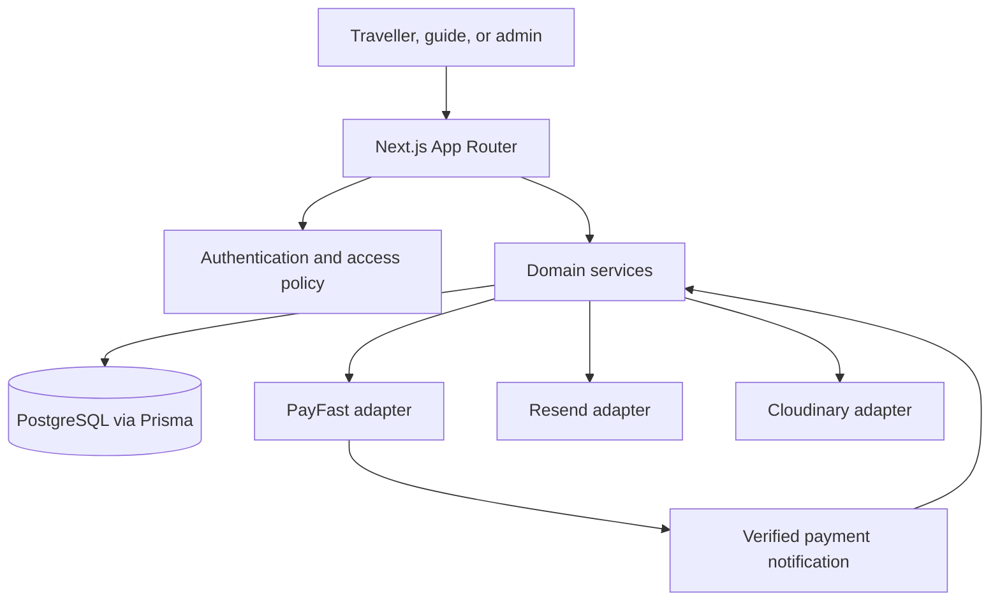

# Nomsa Tour Guides

Nomsa Tour Guides is a South Africa-focused tourism marketplace connecting travellers with verified local guides and experience providers. This repository is being built incrementally as a production-minded MVP, with clear boundaries for future marketplace features.

## Architecture

The MVP uses a **modular monolith**: one Next.js application owns the web experience and backend entry points, while domain modules keep booking, payment, guide, and customer behavior independently understandable. This avoids premature service infrastructure while allowing high-traffic or operationally independent domains to be extracted later.



### Application boundaries

- **Presentation:** App Router pages and layouts render public discovery, account dashboards, and administration. Server Components are the default; client code is reserved for interactive controls that need browser state.
- **Backend:** Route Handlers and Server Actions are thin transport boundaries. They validate input, establish the authenticated principal, authorize the operation, call a domain service, and return a typed result. Business rules do not live in UI components or route handlers.
- **Domain modules:** Accounts and guide verification, catalogue and availability, bookings, payments and payouts, custom requests, reviews, and notifications own their rules and application services. Modules call each other through explicit service interfaces rather than importing one another's persistence details.
- **Persistence:** PostgreSQL is the source of truth, accessed through Prisma. Models use UUID identifiers, explicit relations, timestamps, and indexes for common lookup paths. Booking/payment transitions are persisted transactionally; payment provider callbacks are treated as untrusted, retryable input and made idempotent.
- **External services:** PayFast, Resend, Cloudinary, and Google Maps are isolated behind server-side adapters. Credentials stay in server-only environment variables. Provider-specific response formats do not leak into domain models.

### Core workflows and invariants

1. **Identity and access:** A user may hold multiple extensible roles. Authorization is checked on the server for every protected operation; a guide account cannot publish or accept bookings until its application is approved. Administrator access is separate from public profile data.
2. **Catalogue and availability:** Only active, approved-provider experiences are publicly discoverable. Availability and guest limits are checked on the server when a booking is created, not trusted from search results or the browser.
3. **Booking and payment:** A booking is created in a non-confirmed state before payment. A verified PayFast notification is matched to the expected booking, amount, currency, and reference before a transaction records payment and confirms the booking. Repeated notifications cannot create duplicate payment effects.
4. **Completion and payout:** Reviews and guide payouts are eligible only after service completion. A payout remains blocked until its stored eligibility timestamp, calculated from service completion plus the configured dispute window. Its commission rate and monetary amounts are snapshotted on the payout record; refunds adjust only pending payouts using that stored rate.
5. **Custom requests and reviews:** Custom itinerary requests are idempotent and follow assignment → guide offer → traveller acceptance → PayFast checkout; only verified PayFast notifications confirm payment. Offer terms and cancellation policy are snapshotted into the booking. Reviews are accepted only for completed bookings, are unique per booking, and remain private until an MFA-protected administrator approves them.
6. **Auditability:** High-impact administrative and financial changes record the actor, action, target, and timestamp. Personal documents and banking details are access-restricted and are never exposed through public guide data.

## Technology baseline

The current workspace baseline is **Next.js 16 App Router**, React 19, TypeScript, Tailwind CSS, Prisma 7, PostgreSQL, and Auth.js v5. Authentication uses credentials verified by Argon2id, JWT cookies, and the Prisma adapter. The framework version is intentionally kept at the installed Next.js 16 baseline rather than downgraded to an earlier version.

### Database setup

The PostgreSQL data model is defined in `prisma/schema.prisma`. Copy `.env.example` to `.env` and set `DATABASE_URL` to a PostgreSQL connection string before running Prisma commands:

```bash
npm run db:validate
npm run db:generate
npm run db:migrate
```

`db:migrate` runs Prisma Migrate interactively against the configured development database. The generated client is written to `src/server/db/generated/` and is not committed. The production build runs `prisma generate` before `next build`; `prisma.config.ts` uses a localhost placeholder URL for generation when `DATABASE_URL` is unset.

For a fresh production database, apply committed migrations with `npx prisma migrate deploy`. Existing databases that were created without migration history must be reviewed and baselined before deployment; do not apply the initial migration over an untracked populated schema.

### Deployment (Coolify)

Set `DATABASE_URL` as a **runtime-only** environment variable on the Coolify app. Keep its Build Variable toggle **off**: the Prisma config has a placeholder fallback for client generation during the build, while the app needs the real Coolify-internal connection URL at runtime. The database hostname is an internal network alias and will not resolve from a developer laptop. For local access, use an SSH tunnel (`ssh -L 5432:<db-alias>:5432 user@host`) or enable the database's public port.

Configure Coolify's **Pre-deployment Command** as `npx prisma migrate deploy`. This applies committed schema changes before the new container starts; without it, the app can boot while database queries fail because the schema is missing or outdated.

Create the first migration locally against a local PostgreSQL database with `npx prisma migrate dev --name init`, then commit the resulting `prisma/migrations/` directory. Do not run `migrate dev` or `db push` against the Coolify database. The generated Prisma client in `src/server/db/generated/` is build output and is gitignored.

In Coolify, also configure the required runtime application secrets and service credentials: `AUTH_SECRET`, `AUTH_TOKEN_SECRET`, and (for production outside Vercel) `AUTH_URL`; configure `MFA_ENCRYPTION_KEY` as a separate random secret of at least 32 characters for encrypted authenticator seeds; configure `NEXT_PUBLIC_APP_URL` and `NEXT_PUBLIC_SITE_URL` to the canonical HTTPS origin `https://nomsatourguides.co.za` (`NEXT_PUBLIC_SITE_URL` controls canonical, sitemap, and robots metadata); configure `RESEND_API_KEY` and `EMAIL_FROM` for authentication email flows; set `GUIDE_APPLICATION_TO_EMAIL` to the dedicated guide review inbox (defaults to `guides@nomsatourguides.co.za`) and optionally `GUIDE_APPLICATION_FROM_EMAIL` (defaults to `EMAIL_FROM`); set `BILLING_FROM_EMAIL=billing@nomsatourguides.co.za` for approved-booking invoices and verify the sending domain with Resend; PayFast credentials and settings for payments; `CLEANUP_CRON_SECRET` for the scheduled availability cleanup; and the three `CLOUDINARY_*` values for uploads. Use unique production secrets, not the placeholders in `.env.example`.

Booking capacity is reserved for 30 minutes while PayFast checkout is pending. Configure `CLEANUP_CRON_SECRET` and schedule an authenticated `POST /api/cron/availability-cleanup` at least every five minutes with `Authorization: Bearer <CLEANUP_CRON_SECRET>`. The endpoint processes up to 100 expired reservations per call and reports whether another run is needed.

Guide onboarding document files and bank account numbers are encrypted before persistence. Configure `GUIDE_DATA_ENCRYPTION_KEY` as a unique runtime secret of at least 32 characters, separate from `MFA_ENCRYPTION_KEY`, and preserve it for as long as encrypted guide records must remain readable. Apply the committed guide-onboarding migrations before enabling the onboarding form.

Image uploads require `CLOUDINARY_CLOUD_NAME`, `CLOUDINARY_API_KEY`, and `CLOUDINARY_API_SECRET`. Uploads are authorized against the signed-in profile or guide-owned experience, limited to supported raster image types and 8 MiB, and use transformed Cloudinary delivery URLs.

## Authentication

Copy `.env.example` to `.env` and configure the database, Auth.js secrets, and email sender before using authentication:

| Variable | Required | Purpose |
| --- | --- | --- |
| `DATABASE_URL` | Yes | PostgreSQL connection string used by Prisma. |
| `AUTH_SECRET` | Yes | Auth.js JWT encryption/signing secret. Use a unique cryptographically random value of at least 32 characters. |
| `AUTH_TOKEN_SECRET` | Yes | Separate secret used to key authentication rate-limit identifiers. |
| `MFA_ENCRYPTION_KEY` | For guide/admin authenticator setup | Separate random secret of at least 32 characters used to encrypt TOTP seeds. Preserve it; existing enrolled accounts cannot verify without it. |
| `GUIDE_DATA_ENCRYPTION_KEY` | For guide onboarding document and banking data | Separate random secret of at least 32 characters used to encrypt onboarding files and account numbers. Preserve it; encrypted records cannot be decrypted without it. |
| `AUTH_URL` | Production, unless the trusted host platform provides it | Canonical Auth.js application URL; Vercel supplies a trusted host environment automatically. |
| `NEXT_PUBLIC_APP_URL` | For email flows | Canonical public origin used to generate verification and password-reset links. |
| `NEXT_PUBLIC_SITE_URL` | Production | Canonical website URL used for page metadata, `robots.txt`, and `sitemap.xml`; defaults to `https://nomsatourguides.co.za`. |
| `RESEND_API_KEY` | For email flows | Resend API key. |
| `EMAIL_FROM` | For email flows | Verified sender address, for example `hello@example.com`. |
| `GUIDE_APPLICATION_TO_EMAIL` | For guide applications | Dedicated review inbox; defaults to `guides@nomsatourguides.co.za`. |
| `GUIDE_APPLICATION_FROM_EMAIL` | Optional | Verified sender for guide application notifications; defaults to `EMAIL_FROM`. |
| `BILLING_FROM_EMAIL` | For approved-booking invoices | Must be `billing@nomsatourguides.co.za`; verify the sender domain with Resend. |
| `NOMSA_PLATFORM_COMMISSION_RATE` | Before payout creation | Must be exactly `0.20` (20%). Missing or any other/malformed value blocks payout creation. |
| `PAYOUT_DISPUTE_WINDOW_DAYS` | Before payout creation | Must be exactly `7` calendar days after service completion. Missing or any other/malformed value blocks payout creation. |

Generate secrets independently; do not reuse `AUTH_SECRET` as `AUTH_TOKEN_SECRET`:

```bash
openssl rand -base64 48
```

Guide, admin, and super-admin accounts must enroll an authenticator app before accessing protected account areas. Enrollment stores an encrypted TOTP seed; successful authenticator codes are single-use within their time step. Customers can continue signing in without two-factor authentication.

Then run database validation and generate/apply the Prisma schema:

```bash
npm run db:validate
npm run db:generate
npm run db:migrate
npm run dev
```

The authentication entry point is `auth.ts`, with the Auth.js endpoints mounted at `/api/auth/*`. The application uses JWT sessions with HTTP-only, secure-in-production cookies. Current-user helpers validate the live user record and session version; the Next.js 16 `proxy.ts` performs optimistic route checks, and server-side role helpers remain authoritative. Customer accounts activate after email verification. Guide accounts create a pending application and remain blocked until the application is approved and the account activated. Administrator roles cannot be self-registered.

Registration, login, email verification, reset, and resend actions have database-backed fixed-window rate limits. Verification and password-reset links are random, single-use, time-limited tokens; only SHA-256 token digests are stored. Passwords are hashed with Argon2id. Configure Resend before invoking registration or email actions. Never use development placeholder credentials in production, and set `AUTH_URL`, `NEXT_PUBLIC_APP_URL`, and `NEXT_PUBLIC_SITE_URL` to the same canonical HTTPS origin for deployment.

Authentication routes currently implemented: `/login`, `/register`, `/forgot-password`, `/reset-password`, `/verify-email`, and `/account/change-password`.

### Booking and PayFast

Booking creation requires a PostgreSQL database, a published experience with an availability row for the requested date, and an `Idempotency-Key` UUID. Availability is decremented transactionally; pending reservations remain held until a verified terminal PayFast notification arrives. The idempotency key is stored as a SHA-256 digest and also grants booking lookup through an HTTP-only, booking-scoped cookie.

Set `PAYFAST_SANDBOX` explicitly to `true` or `false`, set `PAYFAST_MERCHANT_ID`, and configure `PAYFAST_SOURCE_IPS` with the current IPv4 addresses or CIDR ranges published by [PayFast Support](https://support.payfast.co.za/portal/en/kb/articles/what-ip-addresses-does-payfast-use). Configure the reverse proxy to overwrite `X-Real-IP` with the connecting client address; the ITN endpoint rejects notifications without a trusted source address. Set `PAYFAST_PASSPHRASE` only when the same passphrase is configured in the PayFast merchant account. Do not use sandbox merchant settings in production.

### Commission and payout policy

Payout creation requires both `NOMSA_PLATFORM_COMMISSION_RATE=0.20` and `PAYOUT_DISPUTE_WINDOW_DAYS=7`; runtime validation rejects any other values and does not silently substitute values when either setting is missing or invalid. The standard platform-wide rate is 20%, rounded to cents using half-up rounding. The seven-calendar-day hold is measured from the persisted service-completion instant in UTC; the exact stored `eligibleAt` boundary is eligible. Payout rows retain the applied rate, post-refund gross amount, commission deduction, guide amount, currency, and absolute eligibility timestamp. A later environment rate change does not re-rate an existing payout; partial refunds recalculate a pending payout with its original stored rate. A payout can be released only after service completion and the hold, with a paid/partially refunded undisputed payment. A compare-and-set update and transaction prevent duplicate releases. Historical payouts missing snapshots are held for manual reconciliation.

Nomsa Tour Guides absorbs PayFast processing fees from its commission initially. No PayFast surcharge or undisclosed processing fee is added to checkout; the traveller pays the persisted booking total. The commission is the gross platform commission before PayFast processing costs, and this application does not currently calculate or persist provider fee deductions. Refunds entered after a guide payout is recorded as paid are rejected for manual reconciliation rather than silently changing the historical payout.

**Finance follow-up:** confirm accounting treatment for PayFast fees, refunds, chargebacks/disputes and VAT, and reconcile the provider’s settlement reports against payout records. The application records manually entered refund/dispute states; it does not execute PayFast refunds or automatically ingest chargebacks. Guide transfers are manually recorded by an administrator and are not initiated by an integrated payout provider.

### Booking journey migration and rollout

The booking and onboarding migrations are ordered lexicographically by their timestamped directory names. The new migrations in this worktree are:

1. `20261018000000_booking_payment_rules`
2. `20261018000001_traveller_booking_journey`
3. `20261018000002_guide_onboarding_statuses`
4. `20261018000003_guide_onboarding_workflow`

They follow the existing `20261016000000_initial_booking_hardening` and `20261017000000_privileged_totp` migrations. The onboarding-status migration must precede the onboarding-workflow migration because the latter uses enum values introduced by the former. Prisma deploys pending migrations in that order. The workflow migration gives every existing experience row a new `DRAFT` verification status, including previously published rows; no existing listing will remain publicly bookable by default. This is intentional: do not backfill approval. Review each existing catalogue record and have an administrator explicitly approve the listings intended to be bookable before launch.

Before applying migrations to any environment:

1. Confirm the target database and current migration state with `npx prisma migrate status`; do not rely on a developer `.env` when operating Coolify.
2. Take a PostgreSQL backup and verify that it is readable, for example `pg_dump --format=custom --no-owner --no-privileges "$DATABASE_URL" --file=nomsa-pre-booking-journey.dump` followed by `pg_restore --list nomsa-pre-booking-journey.dump`.
3. Apply to staging first using the staging runtime `DATABASE_URL` and `npx prisma migrate deploy`. Verify `npx prisma migrate status`, guide/experience approval queues, booking creation, custom offer acceptance, PayFast sandbox ITNs, receipts, messaging, and reviews before scheduling production.
4. Ensure `GUIDE_DATA_ENCRYPTION_KEY` is configured before collecting onboarding documents or bank details, and retain that key in protected backup/recovery storage. Losing it makes encrypted onboarding records unreadable.
5. For production, take a fresh verified backup, confirm the reviewed migration plan and Coolify pre-deployment command, then apply with `npx prisma migrate deploy` against the production runtime database. Do not use `migrate dev` or `db push` in staging or production.

These migrations are additive but include PostgreSQL enum additions and new defaults/constraints; do not attempt a casual down-migration or manually drop columns. If a migration or rollout fails, stop traffic to affected writes, inspect `_prisma_migrations` and database state, and choose a forward corrective migration where possible. Restore the verified pre-migration backup only as an explicit disaster-recovery decision coordinated with application rollback; a database restore can discard bookings and other writes created after the backup. Never mark a migration rolled back or applied with `prisma migrate resolve` until the actual database state has been reconciled.

## Design system

The shared UI foundation lives in `src/components/` and the design tokens are defined in `app/globals.css`. It provides reusable primitives for buttons, cards, form controls, overlays, feedback, navigation, and page layout, along with experience, guide, destination, and booking card patterns. Compose these components in future route pages rather than reimplementing their shared styles.

```tsx
import { Button } from "@/src/components/ui/button";
import { Container } from "@/src/components/layout/container";
import { Section } from "@/src/components/layout/section";

export function ExampleSection() {
  return (
    <Section>
      <Container>
        <h2 className="font-display text-3xl">Explore at your own pace</h2>
        <Button>Find an experience</Button>
      </Container>
    </Section>
  );
}
```

Semantic color utilities (`bg-background`, `text-foreground`, `bg-surface`, `bg-neutral`, `text-muted-foreground`, `border-border`, and the primary, secondary, accent, success, warning, and error tokens) adapt to light and dark mode. `ThemeProvider` uses system preference by default and persists explicit light, dark, or system choices. Use `ThemeToggle` to let a user cycle those modes. Typography utilities include `font-sans`, `font-display`, `font-mono`, and the `text-display`, `text-h1` through `text-h6`, `text-body`, `text-caption`, `text-label`, and `text-button` scale. The `--space-xs`, `--space-sm`, `--space-md`, `--space-lg`, `--space-xl`, and `--space-2xl` CSS variables provide the spacing scale without overriding Tailwind's built-in width utilities.

Use semantic HTML, associate each form control with a visible label, provide accessible names for icon-only controls, keep keyboard focus visible, and respect reduced-motion preferences. Shared controls use Radix primitives where appropriate; custom interactive widgets should retain equivalent keyboard and ARIA behavior. The `FadeIn` and `PageTransition` helpers automatically disable animation when reduced motion is requested. Currency and date formatting utilities default to the South African locale and Rand; image helpers include descriptive alt fallbacks and Cloudinary delivery transforms.

## Public marketing website

The public-facing site is implemented with App Router Server Components and shared Stage 5 components. Public routes are `/`, `/about`, `/contact`, `/destinations`, `/guides`, `/experiences`, `/become-a-guide`, `/transport`, `/privacy`, `/terms`, and `/404`; unmatched paths use the same branded not-found screen. `/transport` is a coming-soon page for planned transport options, linked from the footer and included in the sitemap. The sticky navigation and footer link to the public routes and existing account entry points.

Destinations, guide cards, categories, and testimonials are local illustrative content in `src/data/public-site.ts`; they are not queried from Prisma and must not be presented as verified marketplace activity. The experiences listing uses only approved, published database experiences, and availability filters are checked against persisted capacity. Fixed experiences use instant booking; custom itinerary requests follow guide assignment and a persisted offer that the traveller must explicitly accept before checkout. Custom-request messages are persisted and limited to the traveller and assigned active, approved guide. Reviews require a completed booking and are displayed publicly only after MFA-protected administrator approval. Contact messages are sent through Resend and guide applications are recorded for manual review. The newsletter remains a non-submitting preview. There is currently no seed script or in-app experience publishing workflow, so production must have verified published experience and availability records provisioned before bookings can succeed. Public routes use editable route metadata, canonical URLs, Open Graph/Twitter cards, `robots.txt`, and `sitemap.xml`; set `NEXT_PUBLIC_SITE_URL` to the production canonical origin.

## Source layout

The repository keeps Next.js route conventions in the root `app/` directory and puts reusable application code in `src/`. Route files should stay focused on rendering and transport; domain logic belongs to a feature module or a server service.

```text
app/                         Next.js layouts, pages, and Route Handlers
src/
  components/                Shared presentation components
  features/                  Product domains and their UI
  hooks/                     Shared React hooks
  lib/                       Framework-independent helpers
  schemas/                   Shared runtime validation schemas
  types/                     Shared application types
  server/
    actions/                 Server Action entry points
    auth/                    Server-side identity and authorization
    db/                      Prisma client and persistence setup
    integrations/            Provider adapters (payments, email, media, maps)
    repositories/            Persistence access grouped by domain
    services/                Application and domain workflows
  emails/                    Transactional email templates
  constants/                 Stable application constants
  config/                    Validated server and public configuration
prisma/                      Database schema, migrations, and seed data
public/                      Static assets
```

Domain-specific code should live together under `src/features/<domain>/` when it is presentation- or validation-specific; shared server workflows and adapters live under `src/server/`. Do not add a second `pages/` directory: this project uses the App Router.

## Delivery sequence

Implementation follows the requested order, with each stage validated before moving forward:

1. Project architecture — this document.
2. Folder structure — established by the source layout above and `src/README.md`.
3. Database schema and Prisma models — defined in `prisma/schema.prisma`; no migrations generated.
4. Authentication and role-based authorization — Auth.js, account flows, JWT sessions, and RBAC are implemented.
5. Reusable design system and UI foundation.
6. Public marketing website and static content pages.
7. Customer, guide, and administration features.
8. Booking engine and PayFast integration.
9. Custom requests, reviews, search, notifications, testing, deployment, and complete documentation.

This sequence groups related delivery work while preserving the dependency order in the original brief. Features not yet implemented are not represented as available functionality.

## Local development

Install dependencies using the package manager represented by the lockfile, then start the development server:

```bash
npm run dev
```

Lint the project with:

```bash
npm run lint
```

See the project's scripts in `package.json`. Environment variables and deployment instructions will be documented alongside the integrations that require them; never commit secrets.
